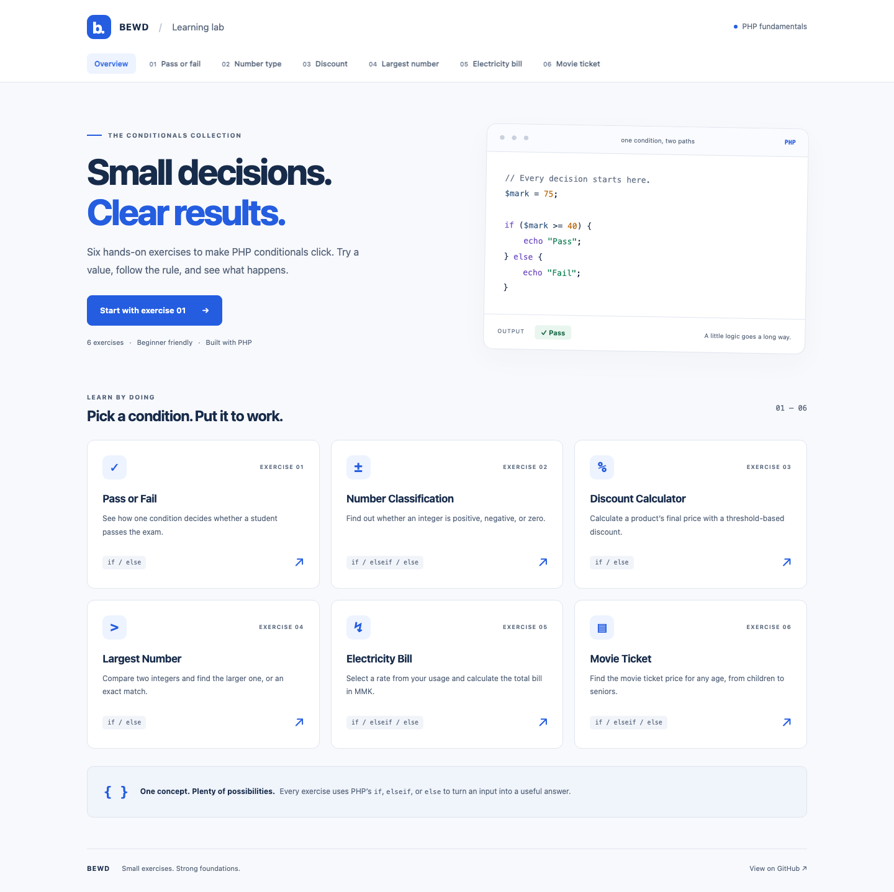
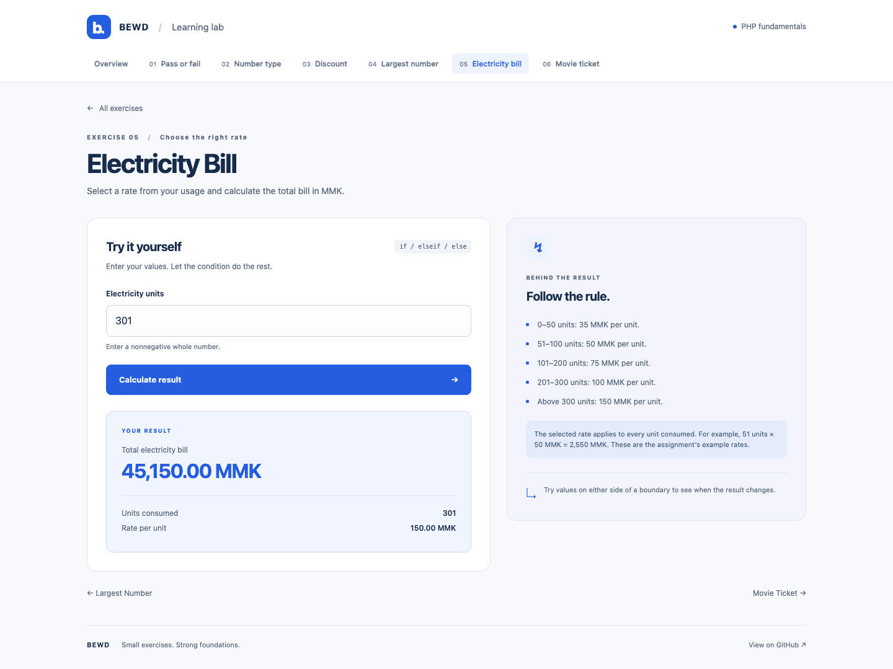
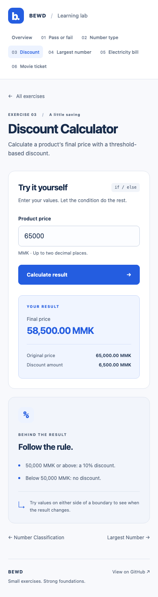

# PHP Conditional Exercises

Six interactive PHP exercises based on the [original assignment](docs/exercise-brief.txt). A shared navbar links every page; forms submit to PHP and display validated results without JavaScript.

## Run

Requires PHP 8.1+ on a 64-bit platform; tested with PHP 8.4.12. There are no external runtime dependencies.

From the `bewd` repository root:

```sh
php -S localhost:8000 -t projects/php-conditionals/public
```

Open [localhost:8000](http://localhost:8000). Use the `public/` directory as the document root so internal source, templates, and tests remain outside the web root.

## Exercises

| Page | Inputs | Rule |
| --- | --- | --- |
| [Pass or Fail](public/exercises/pass-or-fail.php) | Integer mark, 0–100 | Marks of 40 or above pass; lower marks fail. |
| [Number Classification](public/exercises/number-classification.php) | Signed integer | Display Positive Number, Negative Number, or Zero. |
| [Discount Calculator](public/exercises/discount-calculator.php) | Nonnegative product price in MMK | Apply 10% at 50,000 MMK or above; show original price, discount, and final price. |
| [Largest Number](public/exercises/largest-number.php) | Two signed integers | Display the larger number, or Both numbers are equal. |
| [Electricity Bill](public/exercises/electricity-bill.php) | Nonnegative integer units | Rates are 35/50/75/100/150 MMK at the 50/100/200/300 unit boundaries. |
| [Movie Ticket](public/exercises/movie-ticket.php) | Nonnegative integer age | Under 5: free; 5–12: 1,000; 13–17: 2,000; 18–59: 4,000; 60–69: 2,000; 70+: 1,000 MMK. |

Electricity uses the assignment’s **flat rate for all units**, rather than accumulating tiered charges. For example, 51 units cost `51 × 50 = 2,550 MMK`. The rates are learning examples from the brief.

## Source organization

```text
php-conditionals/
├── public/           # Home, exercise entry points, and CSS
├── src/              # Catalogue, calculations, validation, and display helpers
├── templates/        # Shared header, footer, and exercise page
├── tests/            # Dependency-free PHP checks
└── docs/             # Original brief and browser screenshots
```

Each exercise entry point selects its catalogue key and loads the shared page. The catalogue provides labels, rules, fields, navigation, and the calculation function. Calculation functions return data; templates render it with HTML escaping.

Forms accept decimal prices with at most two fractional digits. Internally, `$price` is stored in integer cents; the threshold is `50_000 * 100`. Discounts round half up to the nearest cent, and every monetary result includes two decimal places and `MMK`. This keeps calculations and formatting exact without floating-point arithmetic.

Integers must fit PHP’s signed integer range. Money must fit that range in cents. Electricity units are capped at `intdiv(PHP_INT_MAX, 150)` to keep the maximum bill within the same range. Invalid or missing values produce field-specific errors and retain the submitted text. Commas and scientific notation are not accepted as numeric input.

The app stores no user data and needs no database, session, framework, or client-side script. Styling uses local CSS and system fonts.

## Verification

From the repository root:

```sh
php projects/php-conditionals/tests/run.php
find projects/php-conditionals -name '*.php' -print0 | xargs -0 -n 1 php -l
```

The test runner exits nonzero on failure. It covers pass/fail, every number classification, discount rounding and thresholds, comparisons and equality, all electricity and movie-ticket boundaries, blank/malformed/array inputs, range limits, exact money formatting, HTML escaping, and URL generation.

Browser verification covers valid and invalid POST submissions, retained inputs, escaped HTML, navigation, and horizontal overflow at 320, 390, 768, and 1440 pixel viewport widths. The screenshots below were captured from the running PHP application.

## Screenshots

### Home page



### Electricity result



### Mobile form and result


